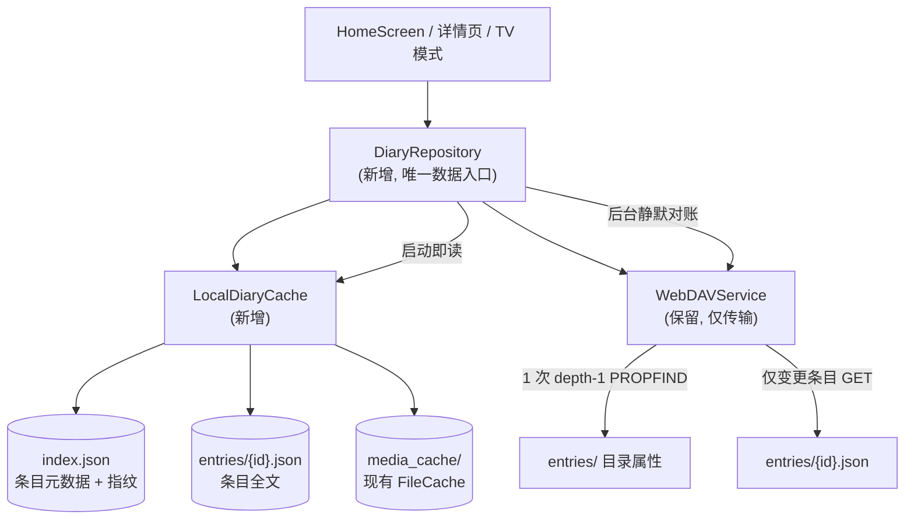

# Growth Diary 存储与加载性能优化设计（家庭自用版）

> 修订版 v2 · 2026-11-13
> 替换 v1 的关键变化：不做服务端与数据库；远端数据格式零改动、零迁移；首屏优化以"本地优先缓存 + 目录属性差分"为主路径，`manifest.json` 退为条件触发的可选优化；补充了 v1 遗漏的缩略图、分页、TV 模式与写入队列兼容问题。

## 0. 结论摘要

| 项 | 决定 |
| :--- | :--- |
| 后端服务 / 服务端数据库 | **不做**。目标为家庭自用，数据留在用户自己的 WebDAV，README 的隐私承诺不变 |
| 远端数据格式 | **不改**。`entries/{id}.json` 字段不变，旧版 App 与新版 App 双向可读 |
| 首屏优化主路径 | **本地优先缓存 + `PROPFIND` 目录属性差分**。热启动 0 次网络请求即可渲染，后台 1 次请求对账 |
| `manifest.json` | **暂不引入**。理由见 §2.3，触发条件见 §5.3 |
| 新增依赖 | 0。沿用 `path_provider` + `shared_preferences` + `webdav_client` |
| 新增请求成本 | 稳态 1 次 PROPFIND；`read()` 前的多余 OPTIONS 见 §3.11 |
| 数据迁移 | 0。本地缓存是可丢弃的派生数据，删除目录即回滚 |
| 分期 | Phase 1 本地优先（主收益，约 3–4 人天）；Phase 2 写入侧补强（按需）；Phase 3 分片与清单（有实测触发条件才做） |

---

## 1. 现状与真实瓶颈

### 1.1 代码现状

- **配置**：`growth_diary/{id}/config.json`，本地由 `SharedPreferences` 缓存（`app_configs` 键）。
- **条目**：`growth_diary/{id}/entries/{uuid}.json`，一条一个文件，无索引。
- **加载**：`loadAllEntries()` 先 `readDir`（depth-1 PROPFIND），再 `for` 循环逐条 `read`（[webdav_service.dart:204-228](lib/services/webdav_service.dart#L204-L228)），全程串行。
- **本地缓存**：只有媒体文件缓存（`FileCache`，<documents>/media_cache），条目 JSON 没有任何本地副本。
- **写入**：编辑页、详情页、媒体上传完成回调三处直接 `saveDiaryEntry`，无版本字段、无并发控制。
- **分页**：`loadEntriesPage(offset, limit)` 已存在并接到滚动加载（[home_screen.dart:343-357](lib/screens/home_screen.dart#L343-L357)），但主加载已经全量取完，`offset = _entries.length` 恒等于总数，`clamp` 后区间为空（[webdav_service.dart:277-291](lib/services/webdav_service.dart#L277-L291)）。**这是一个从未生效的分页。**
- **隐藏的双倍往返**：`webdav_client` 的 `read()` 每次 GET 前都会先发一个 `OPTIONS`（`wdReadWithBytes` 内先 `wdOptions` 再 `GET`），而首次请求还会因 `NoAuth` 收到 401 再重试一次。也就是说每条日记实际是 2–3 次往返，500 条不是 500 次请求，是 1000 次以上；缩略图走同一个 `read()`，同样翻倍。首屏"像卡死"有一半原因在这里。
- **PROPFIND 响应未压缩**：该库在 PROPFIND 请求头里显式写了 `accept-encoding: ''`，目录列表是原样 XML 下行。条目数量大时这会显著放大 §1.2 里的 PROPFIND 流量。

### 1.2 量化瓶颈

单位：条目数。请求数为"打开一次首页"的网络请求总数，**包含每次 `read` 前的 OPTIONS**。

| 指标 | 500 条 | 2000 条 |
| :--- | :--- | :--- |
| 现状请求数 | 约 1000（1 PROPFIND + 500×(OPTIONS + GET)） | 约 4000 |
| 现状首屏（局域网 RTT 20ms，串行） | 约 20–30 s | 约 80–120 s |
| 现状首屏（公网 RTT 100ms，串行） | 约 100–150 s，多数会撞 15s 连接 / 60s 读超时 | 超过 400 s，基本不可用 |
| 现状每次打开条目流量 | 约 1 MB | 约 4 MB（按 2 KB/条估） |
| depth-1 PROPFIND 响应体（未压缩） | 约 150 KB | 约 0.5–0.7 MB |
| 条目元数据索引体积（本地） | 约 80 KB | 约 320 KB |
| 时间轴首屏所需缩略图 | 可见 10 条约 30–90 张，每张 OPTIONS + GET | 同左 |

> 以上均为量级估算，Phase 1 落地时用 `debugPrint` 打点 + 真机实测校准，并在验收表（§7）里替换成实测值。v1 文档中"每次数十 MB 重复流量"与"2000 条清单小于 150KB"两个数字偏离实际，已删除；v1 的"501 / 2001 次请求"也低估了一半，因为它没算每次 `read` 前的 OPTIONS。

### 1.3 三个 v1 未提及、但直接影响体验的问题

1. **网络失败被当成"没有数据"**：`loadAllEntries()` 捕获异常后 `return []`（[webdav_service.dart:242-256](lib/services/webdav_service.dart#L242-L256)），`HomeScreen` 拿到空列表走空状态分支（[home_screen.dart:1050](lib/screens/home_screen.dart#L1050)、[1082](lib/screens/home_screen.dart#L1082)）。网络抖一下，用户看到的是"日记全没了"，而不是错误提示。这是当前最伤用户的症状，离线优先首先修它。
2. **缩略图逐张请求**：时间轴卡片要 `description` 全文与最多 9 张缩略图（[timeline_item.dart:121-123](lib/components/timeline_item.dart#L121-L123)、[215-235](lib/components/timeline_item.dart#L215-L235)），每张一次 `downloadFile`，命中磁盘缓存才免请求。首屏 10 条就是几十次请求，这部分不是 `manifest` 能解决的，只能靠本地缓存。
3. **TV 模式每次 build 展开全部媒体**：`_buildTvLayout` 里直接调 `_getTvMediaItems()`（[home_screen.dart:2286-2318](lib/screens/home_screen.dart#L2286-L2318)、[2518-2525](lib/screens/home_screen.dart#L2518-L2525)），把全部条目展开成一个媒体扁平列表，条目多时每次重建都要遍历上万条。

### 1.4 目标与非目标

**目标**
- 热启动首屏 < 200 ms（本地索引直接渲染，不等网络）。
- 稳态每次打开的网络请求：1 次 PROPFIND（无变更时 0 次 GET）。
- 断网可浏览全部历史（含缩略图，命中缓存的部分）。
- 与旧版本 App 双向共存，不产生格式割裂。
- 零新增原生依赖，兼容现有 Android / iOS / TV / HarmonyOS 构建。

**非目标**
- 实时多端同步（WebDAV 无推送，家庭场景不需要）。
- 服务端搜索、账号体系、共享相册。
- 条目版本号与冲突裁决放在 Phase 2，Phase 1 不引入。

---

## 2. 方案选型

### 2.1 候选方案

| | A. 本地优先 + 属性差分 | B. 远端 manifest 清单 | C. 本地 SQLite |
| :--- | :--- | :--- | :--- |
| 远端改动 | 无 | 新增 `manifest.json`，双写 | 无 |
| 数据迁移 | 无 | 首次需扫描生成，需自愈逻辑 | 无 |
| 热启动首屏 | 本地索引，< 100 ms | 需先取清单，弱网下受 RTT 影响 | 本地查询，< 50 ms |
| 稳态请求 | 1 PROPFIND | 1 depth-0 PROPFIND（清单小） | 1 PROPFIND |
| 旧版写入可见 | 天然可见（文件属性变了） | 默认不可见，需额外对账 | 天然可见 |
| 双写丢失更新 | 不存在 | 存在（两设备同时改清单会丢行） | 不存在 |
| 离线 | 完整 | 完整 | 完整 |
| 新增依赖 | 0 | 0 | sqflite（原生依赖，HarmonyOS 与 Web 需额外验证） |
| 主要风险 | 无结构性风险 | 清单与目录不一致 | 构建链变更 |

**选 A**。C 的数据量收益在 2000 条这个规模上等于零（SQLite 处理百万行都不吃力），却引入原生依赖与 HarmonyOS 适配风险，不划算；只有条目数上万、需要复合条件查询时才考虑。

### 2.2 为什么不上后端服务

详见讨论结论，此处只留判定依据：

- 2000 条记录对任何数据库都是零压力，瓶颈在传输形态，不在存储引擎。
- 上后端等于把"数据在用户自己服务器上"换成"数据在我们服务器上"，要改隐私政策、担运维责任、迁移历史数据，而离线缓存与同步引擎的工作量一分不少。
- 家庭自用场景只有 1–2 台手机 + 1 台 TV、1 个 WebDAV，后端的核心独有能力（变更推送）价值不足以覆盖成本。

若将来转为公开多用户产品，应整体按 SaaS 重新设计（Postgres + 对象存储 + 同步中枢，客户端仍 Local-First），而不是在现有架构上叠加。

### 2.3 为什么 Phase 1 不引入 manifest

v1 的清单方案有三个无法回避的问题：

1. **清单撑不起时间轴**。时间轴卡片要 `description` 全文和每个条目的全部缩略图（最多 9 张）。清单里只放 `summary` + `firstThumbnail`，要么改 UI（只显示一张图 + 截断文案），要么把 `description` 和缩略图数组塞进清单。后者 2000 条约 2–4 MB，比直接 PROPFIND 还贵，"1 次请求出首屏"的名头就没了；前者是产品退让，v1 没有讨论。
2. **清单不能当真相源**。旧版 App 新增条目只写 `entries/{id}.json`，不碰清单。新版按清单渲染，会直接看不见这篇新日记。要修就得加新鲜度对账（比对目录），而对账本身就要 1 次 PROPFIND——和方案 A 一模一样，清单成了纯额外成本。
3. **双写引入丢失更新**。WebDAV 没有 `If-Match` 条件写，清单更新必然是 GET→改→PUT，两台设备同时保存就丢行。丢行能靠目录扫描自愈，但自愈就是全量扫描，代价比省下的那点流量高。

**方案 A 恰好把这三件事都绕开了**：目录里的文件名与属性就是索引，文件变了属性必变，旧版写入天然可见，不需要双写，也不存在清单被覆盖。省下的 `manifest` 复杂度全部可以投到真正影响体验的地方（本地缓存、缩略图并发、错误语义）。

清单在什么情况下才值得？当 depth-1 PROPFIND 的响应体和解析时间成为可观成本时（§5.3 给出阈值），因为它能把"无变更"的快路径压到 1 KB 级别。这需要实测数据支撑，不该作为第一版的前提。

### 2.4 关键取舍：远端只读 + 本地可弃

远端保持"一条一日记一文件"的现有结构，Phase 1 **不新增任何远端文件、不改字段**。本地缓存是可丢弃的派生数据：删掉只会触发一次重新拉取，永远不会丢掉用户的日记。这条约束保证了迁移风险为零、回滚成本为零。

---

## 3. Phase 1 详细设计

### 3.1 结构



职责划分：
- `WebDAVService` 只负责传输，新增两个能力：列目录属性、按 id 读单条。
- `LocalDiaryCache` 只负责本地文件的原子读写与索引维护。
- `DiaryRepository` 负责编排：先出本地数据 → 后台同步 → 变更通知。UI 不再直接调 `cloudService` 读条目。

### 3.2 本地存储布局

```
<documents>/growth_diary_cache/<configId>/
  index.json          # 元数据索引（单一文件，原子替换）
  entries/<id>.json   # 条目全文，内容与远端一致
  sync_state.json     # lastSyncAt / lastError / schemaVersion
<documents>/media_cache/   # 沿用现有 FileCache，不改位置
```

`<configId>` 即 `AppConfig.id`，也就是远端 `growth_diary/{id}/` 的那段 id。每个宝宝一个目录，切换宝宝互不污染。

### 3.3 `index.json` 结构

```json
{
  "schema": 2,
  "configId": "uuid-xxx",
  "syncedAt": 1731500000000,
  "entries": [
    {
      "id": "entry-uuid-1",
      "dateMs": 1763035200000,
      "ageInMonths": 14,
      "imageCount": 3,
      "videoCount": 1,
      "etag": "\"5f3a-1a2b3c\"",
      "mtime": 1731500000000,
      "size": 1842
    }
  ]
}
```

设计要点：
- **只放元数据**，不放 `description`、不放缩略图路径。卡片正文与缩略图从 `entries/{id}.json` 按可见窗口懒读，避免单文件 2–4 MB 的解析与重写成本。
- `imageCount` / `videoCount` 供统计与 TV 列表头使用，避免为了计数加载全部 body。
- `etag` / `mtime` / `size` 是差分指纹，`etag` 缺失时退化为 `mtime:size`。
- 索引按 `dateMs` 降序存放，加载后无需再排序。
- **日期存毫秒整数，不存 ISO 字符串**。实测 2001 条的索引里，逐行 `DateTime.parse` 要 90ms 左右，改成 `DateTime.fromMillisecondsSinceEpoch` 后首屏索引解析从 410ms 降到 60ms（profile 构建，见附录 B）。索引是可丢弃的缓存，schema 变更直接丢弃重建，不需要迁移代码。

### 3.4 同步算法

```
sync():
  remote ← PROPFIND(entries/, depth=1)          // 1 次请求，返回 name/mtime/size/etag
  remoteRows ← remote 中 .json 文件 → (id, etag, mtime, size)

  added   ← remoteRows - localIndex.keys
  changed ← remoteRows 中 指纹与 index 不一致的
  removed ← localIndex.keys - remoteRows.keys   // 远端已无此文件

  并发 4 路 GET added + changed 的 body
  本地删除 removed 对应的 body
  原子写 index.json（以 remoteRows 为准，重建元数据）
  通知 UI 局部刷新
```

差分只在"证明没变"时才跳过。判定顺序：`etag` 非空且两端一致 → 未变；否则 `mtime` 与 `size` 都一致 → 未变；否则视为变更（宁可多拉一次）。

`removed` 的处理与删除语义相关，见 §4.3。

同步节流：距上次成功同步不足 60 s 时跳过后台对账，下拉刷新与"编辑/新增完成后"强制触发。避免切回前台、切宝宝、TV 唤醒这些高频动作各打一次 PROPFIND。

### 3.5 三种启动路径

| 场景 | 网络请求 | 首屏路径 | 实测（profile，夹具 20ms RTT） |
| :--- | :--- | :--- | :--- |
| 热启动（有缓存） | 0（渲染）+ 1（后台对账） | 读索引 → 首屏 12 条 body → 渲染 → 后台补其余 body → PROPFIND 对账 | 500 条首屏 93ms；2000 条首屏 113ms；整个进程共 11 次请求（8 次是启动时的 MKCOL） |
| 首次安装 / 换机 | 1 PROPFIND + N×GET | **分批拉取**：首批 40 条按 mtime 倒序先到，时间轴立即可用，其余按批后台补齐（顶部显示进度） | 首批 1.4–1.9s 出首屏；500 条全部到齐 8.1s、2000 条 25.8s |
| 离线 | 0 | 有缓存则完整可用；无缓存显示错误态 + 重试 | 热启动 719ms 出首屏，同步失败提示"离线模式" |

首次安装的 N 次 GET 无法消除（数据只能一条条取），但它是**一次性**成本，且可以并发、可以后台、可以续传。v1 文档承诺的"从 O(N) 降到 O(1)"只对稳态成立，对首次安装不成立，这里明确区分。

启动分三步，实测下来第一步只要 25–60ms：

1. 读 `index.json`（单文件，元数据），拿到全部条目的日期与数量；
2. 只解析首屏 12 条的 body，立刻出第一帧（不等网络、不等剩余 body）；
3. 背景补齐剩余 body（500 条约 0.9s、2000 条约 1.2s），同时发 1 次 PROPFIND 对账。

首屏 12 条是经验值：再多会把 `DateTime` 解析与卡片构建压到首帧里，再少会让快速滚动出现空白。

### 3.6 内网 / 外网镜像

现状是同一服务的内外网两个映射（`resolveEffectiveUrl`，[webdav_service.dart:39-88](lib/services/webdav_service.dart#L39-L88)），因此：

- **缓存按 `configId` 分键，不按 URL 分键**。两条通道指向同一份数据，缓存可以放心共用。
- **URL 只是传输通道**，可能在一次会话中途切换（WiFi 切换）。同步过程中若 `_currentUrl` 变化，客户端重建并按当前 URL 重试一次，不做特殊处理。
- **ETag 视为不透明字符串**。同一后端产生的 ETag 在两条通道上应一致；若反向代理改写了 ETag（例如 gzip 代理追加后缀），后果只是"误判为变更"→ 多拉一次 body，不影响正确性。因此指纹比对失败时一律保守地重新拉取，不做"ETag 不同就必定内容不同"的推断。
- 将来若真的出现两份独立副本，缓存键再改为 `(configId, url)`，代码里留注释标记这个假设即可。

### 3.7 原子写与自愈

本地写入统一走"临时文件 + 替换"：
1. 写 `index.json.tmp`，`flush: true`。
2. 目标文件存在则替换（Windows 上 `rename` 覆盖已存在文件会失败，需先删再 rename；移动端 POSIX 语义可直接覆盖）。
3. 索引损坏 / 解析失败 / `schema` 不匹配 / `entries` 目录文件数与索引条目数不符 → 丢弃索引，退化为"按目录全量重建"（等价于首次安装的后台路径）。

远端写入**不做** temp + rename 两跳：WebDAV 单文件 PUT 在主流服务端（Nextcloud / nginx dav）已是原子替换，加 `MOVE` 只会多一次请求，并且部分服务端会禁用 `MOVE` 覆盖。v1 文档的"先写临时文件再重命名"对远端不适用，仅对本地缓存有效。

### 3.8 缩略图缓存

- 媒体文件名由内容哈希生成（`FileUtils.generateFileName`，[file_utils.dart:284](lib/utils/file_utils.dart#L284)），换图必然换名，因此**不需要给缓存键加版本号**，天然不会读到旧缩略图。
- 现在缺的是容量治理：`FileCache.put` 只写不淘汰（[file_cache.dart:52-71](lib/services/file_cache.dart#L52-L71)），长期使用会无上限增长。Phase 1 加一个启动时的容量检查（默认上限 500 MB），超限按 `lastModified` 从旧到新删除。
- 时间轴首屏只请求可见窗口的缩略图，`ListView` 的懒加载已经保证了这一点，不改。

### 3.9 分页与渲染

- 删除远端分页逻辑（`loadEntriesPage` 里的 `readDir` + 按 `mtime` 排序再按 `date` 重排，[webdav_service.dart:260-300](lib/services/webdav_service.dart#L260-L300)），改为在本地索引上做游标分页：游标 = `(date, id)`，`limit` 默认 10，滚动到底从索引继续取，**不联网**。
- `_hasMoreData` 改为索引比较，不再用"本页是否取满 10 条"这种会误判的写法（[home_screen.dart:263](lib/screens/home_screen.dart#L263)、[356](lib/screens/home_screen.dart#L356)）。
- 月分组、时间轴抽屉、统计数据全部改为从索引计算，不读 body。
- TV 模式的 `_getTvMediaItems()` 记忆化到「条目修订号 + 过滤条件」上（已落地），避免每次 build 全量遍历；按可见行懒展开留待后续。

### 3.10 错误语义

三种状态必须分开，不能共用空状态：

| 状态 | 条件 | UI |
| :--- | :--- | :--- |
| 首次加载中 | 无索引 + 请求进行中 | 骨架屏 / 进度 |
| 有缓存但同步失败 | 索引存在，PROPFIND 失败 | 正常渲染 + 顶部轻提示"离线模式，数据可能不是最新"，可点击重试 |
| 无缓存且请求失败 | 无索引，PROPFIND 失败 | 错误态 + 重试按钮，**不再显示"还没有记录"** |

### 3.11 处理每次 `read` 前的 OPTIONS（独立于本地缓存，收益明确）

现状每条日记、每张缩略图都要先 OPTIONS 再 GET，等于把网络开销翻倍。三种处理方式，按侵入程度排序：

1. **并发**：首次安装与缩略图预取都用 4–6 路并发，让 OPTIONS 与 GET 在时间上重叠。墙钟收益明显，但请求总数不变，适合不想动依赖的情况。
2. **绕开库的封装**：`webdav.Client` 的 `c` 字段是公开的 `WdDio`，可以直接 `client.c.req(client, 'GET', path, ...)` 跳过 `wdReadWithBytes` 里的 `wdOptions`。代价是依赖内部 API，需要包一层 `_readRaw()` 并保留 `client.read()` 作为兜底。
3. **vendoring（已采用）**：把 `webdav_client` 复制进 `depends/webdav_client-1.2.2`，删掉 `wdReadWithBytes` / `wdRead2File` / `wdWriteWithBytes` / `wdWriteWithStream` 四处 OPTIONS 预检，用 `dependency_overrides` 指过去。项目本来就有 `depends/video_player_android` 的先例。

实际做法是方案 1 + 方案 3：先靠并发把首屏体验拉起来，再 vendoring 把请求数从根上减半。`depends/webdav_client-1.2.2` 中删掉的四处预检都有注释标记，升级该依赖时要重新打这个补丁。

实测收益（500 条）：首次安装请求 1027 → 518，同步耗时 39.8s → 23.9s；稳态请求同步减少（config 读取与缩略图下载各自少一次往返）。

PROPFIND 的 gzip 已开启（vendoring 时把 `accept-encoding` 从空改成 `gzip`，dart:io 自动解压）。实测 2000 条的目录响应 1,044,892 → 27,228 字节，暖启动同步耗时 942ms → 587ms。

---

## 4. Phase 2（按需，不阻塞 Phase 1 上线）

### 4.1 离线新增

家庭场景里最常见的写入是"随手记一条"，弱网下应该能先存本地。做法：

- 新增 `pending_writes.json`（或复用 [media_upload_service.dart:312-336](lib/services/media_upload_service.dart#L312-L336) 的 `upload_tasks.json`，但不要引入第二套队列状态）。
- **只支持离线新增，不支持离线编辑与删除**。编辑涉及冲突裁决，收益低风险高。
- 新增条目先写本地，索引临时标记 `pending: true`（旧索引缺该字段视为 false），联网后 PUT 到远端，成功则清标记。若 PUT 失败且远端已存在同 id 文件，生成副本而不是覆盖。

### 4.2 编辑冲突（已落地）

现状是三处直接覆盖写，两端同时改同一条会静默丢失。已按下面的规则实现（`lib/utils/revision_merger.dart`）：

- `DiaryEntry` 增加可选字段 `updatedAt`（int，毫秒）、`rev`（int，从 1 开始）、`deviceId`（String）。全部给默认值，`fromJson` 缺失时视为 `rev = 0`，保证旧文件可读。
- **保存前先读远端**：`saveDiaryEntry` 先用 `readDir` 判断远端是否已有该 id，有则读取用于裁决。读失败会中止保存而不是当成新建，避免网络抖动把远端内容覆盖掉。
- 裁决规则：
  1. 远端不存在 → 写入，`rev + 1`；
  2. 内容完全相同（忽略版本字段）→ 只递增 `rev`；
  3. 远端没有版本信息（旧版本写的）→ 直接覆盖并置 `rev = 1`，否则**第一次编辑老日记就会多出一份副本**；
  4. `rev` 不同 → `rev` 大的一方留在原 id，另一方另存为「冲突副本」；
  5. `rev` 相同 → `updatedAt` 较新的一方留在原 id；两边时间差超过 5 分钟视为时钟不可信，**两份都保留**。
- 冲突副本用新 uuid、标题加「（冲突副本）」后缀，因此条目总数会变多，靠现有同步自然会出现在时间轴上。
- 保存当下会即时提示：`CloudStorageService.conflictListener` 回调把副本推给首页，弹出「已保留为冲突副本」提示并自动刷新列表，不需要等下次冷启动。
- **兼容雷点**：上传任务队列会把 `DiaryEntry` 整个序列化进 `upload_tasks.json`（[media_upload_service.dart:325-327](lib/services/media_upload_service.dart#L325-L327)、[394-397](lib/services/media_upload_service.dart#L394-L397)）。加字段后，老版本写下的队列文件在新版反序列化时必须走默认值，不能抛异常；反过来新版写下的队列文件被旧版读取时也一样。这一点必须在 Phase 2 动工前测过。
- 写入点共三个：编辑页（[diary_editor_screen.dart:83](lib/screens/diary_editor_screen.dart#L83)、[91](lib/screens/diary_editor_screen.dart#L91)）、详情页（[entry_detail_screen.dart:209](lib/screens/entry_detail_screen.dart#L209)）、上传完成回调（[media_upload_service.dart:985](lib/services/media_upload_service.dart#L985)）。

### 4.3 删除语义

- Phase 1 保持物理删除（现状：连媒体一起删，[webdav_service.dart:638-670](lib/services/webdav_service.dart#L638-L670)）。本地同步看到远端文件消失，就从索引与本地 body 里移除。
- **不引入软删除墓碑**。v1 的阶段三软删除与"旧版本兼容"直接冲突：旧版 `readDir` 会把 `isDeleted` 的文件当正常日记显示，等于删不掉；而且一旦打标不删文件，媒体文件也不敢删，存储只增不减。只有两端 App 都升级完成后，才值得重新评估墓碑方案，且必须同时规定墓碑保留期与物理清理策略。

---

## 5. Phase 3（有实测触发条件才做）

### 5.1 触发指标

| 优化项 | 触发条件 |
| :--- | :--- |
| 目录按年分片 `entries/YYYY/` | 条目数 > 1000，或 depth-1 PROPFIND 的 P95 耗时 > 400 ms，或响应体 > 1 MB |
| 引入 `manifest.json` | 分片后当年目录的 PROPFIND 仍 > 300 KB，且实测"无变更打开"占比 > 80% |
| 本地 SQLite | 条目数 > 20000，或出现跨字段复合查询需求 |

> 阈值原先按**未压缩**的 PROPFIND 评估。现在已经通过 vendoring 打开 gzip：2000 条的 depth-1 PROPFIND 从 1,044,892 字节压到 27,228 字节（约 38 倍），上面三条流量阈值基本失效，真正约束改成"单次 PROPFIND 解析耗时"和"目录条目数"，下次实测后再定。

### 5.2 分片方案

- 新路径 `entries/YYYY/{id}.json`，年份取条目 `date`。
- 兼容读取：新路径不存在则回退旧平铺路径，写入一律走新路径（存在 dual-read 期间）。
- 分片后 depth-1 只扫当年目录，跨年目录各做一次 depth-0 或按需扫描。**分片不是免费午餐**，它让"一次请求看全部"变成"多次请求看全部"，所以在条目数不大时反而是负优化，必须等触发条件。

### 5.3 若引入 manifest，必须满足的约束

写在这里是为了避免下一轮又走回 v1 的坑：

1. **不变量**：`entries/` 是唯一真相，`manifest.json` 是派生缓存，任何时刻都可被目录扫描重建。客户端不得因清单缺失或过期而少显示数据。
2. **新鲜度校验**：每次同步 `readProps(manifest.json)` 取 eTag（`webdav_client` 支持，`File` 带 `eTag/mTime/size`），与本地记录比对；eTag 变化才下载清单。清单内不能放"自身的 lastModified"来做变更判断，那是循环依赖。
3. **写入端全覆盖**：只有在所有写入端（编辑页、详情页、上传回调）都更新清单时，才允许跳过目录对账；否则必须保留周期性对账（下拉刷新、启动后每 N 分钟一次）。
4. **不进内容**：清单不放 `description`、不放缩略图数组，否则 2000 条约 2–4 MB，失去意义。时间轴靠本地 body 缓存渲染。
5. **分片**：按年拆 `manifest/YYYY.json`，把双写冲突面从整库降到一年，并允许只下载当年清单。

---

## 6. 兼容性与回滚

### 6.1 新旧版本共存矩阵

| 场景 | 结果 | 说明 |
| :--- | :--- | :--- |
| 旧版读新版写的条目 | 正常 | 字段未变，新增字段被旧版忽略 |
| 新版读旧版写的条目 | 正常 | 指纹来自文件属性，旧版一写属性就变，差分能发现 |
| 旧版删新版正在看的条目 | 正常 | 本地同步发现文件消失后移除 |
| 新版离线新增 + 旧版在线新增 | 正常 | 两者写的是不同 id 的文件，无共享索引文件可冲突 |
| 上传队列跨版本读取 | 需测 | Phase 2 加字段时才成为风险，见 §4.2 |

### 6.2 回滚

1. 删除 `<documents>/growth_diary_cache/<configId>/`，恢复旧加载路径。
2. 远端不受影响——Phase 1 不写任何新远端文件、不改任何字段。
3. 回滚后唯一损失是本次缓存，用户数据零风险。

### 6.3 数据安全原则

- 远端只做"读属性 + 读单条 + 原有写入"，Phase 1 不新增远端删除、不改写历史文件。
- 本地索引与 body 都是派生数据，任何解析失败一律重建，不做"修复后回写远端"的动作。

---

### 6.4 升级与旧数据：需要做什么

结论：**远端和本地都不需要迁移脚本，但升级后有一次性建缓存的开销，且有两处保护要确认。**

| 数据 | 是否需要处理 | 说明 |
| :--- | :--- | :--- |
| 远端 `entries/{id}.json` | 不需要 | 字段未改；新版本只读取自己认识的字段，旧版本忽略新增的 `rev/updatedAt/deviceId` |
| 远端 `config.json` | 不需要 | 结构未改 |
| 本地 `media_cache/` | 不需要 | 目录与缓存键都没变，升级后缩略图命中旧缓存，不会重复下载 |
| `upload_tasks.json` | 不需要 | `DiaryEntry.fromJson` 对新字段有默认值，旧队列文件能正常反序列化（冒烟测试已覆盖） |
| SharedPreferences | 不需要 | 只新增 `device_id` 与 `media_cache_limit_mb` 两个键，缺失时用默认值 |
| 本地条目索引 | 首次生成（分批） | 旧版本没有索引，升级后第一次打开会建缓存：**首批 40 条约 1.5–2s 就能看到时间轴**，其余按批后台补齐，顶部显示"正在补齐历史日记 n / 总数"；500 条全部到齐约 8s、2000 条约 26s |

升级期的两个保护（已实现）：

1. **远端整体为空时不清本地**：后台同步拿到空目录会报错并保留本地缓存，只有下拉刷新（显式操作）才接受"远端真的被清空"。避免配置指错目录、服务端故障、权限变化时把用户本地数据一起清掉。
2. **旧条目首次编辑不产生副本**：旧数据没有 `rev`，第一次编辑时按 `rev = 1` 直接覆盖，不会因为"远端没有版本信息"被误判成冲突。

用户/运维不需要做的事：不要手动清远端 `entries/` 目录，不要手改 `config.json`，不需要预先升级所有设备。旧版本 App 仍可继续读写，只是它写出的条目没有版本号，两端同时编辑时冲突会以"远端无版本 → 直接覆盖"处理。建议两端都升级后再依赖冲突副本功能。

### 6.5 服务器连不上时的行为

| 场景 | 表现 |
| :--- | :--- |
| 有本地缓存 + 冷启动 | 从本地索引直接渲染，首屏 ≈ 130–270ms；同步失败后弹具体原因（如「无法连接 WebDAV 服务器，请检查网络或服务器地址，正在显示本地缓存」）+ 重试按钮，时间轴、已缓存的缩略图都能正常看 |
| 无本地缓存（首次安装/换机） | 显示友好错误「无法连接 WebDAV 服务器，请检查网络或服务器地址」+ 重试按钮，不再抛原始 `HttpException` |
| 启动页 | 不再等待网络：初始化只做本地准备，目录创建与远端配置都放后台。之前服务器超时会卡在启动页最多 15s |
| 使用中编辑/新增 | 保存会失败并提示，编辑器保留已输入内容，可等网络恢复后重试；不会静默丢数据 |
| 媒体上传中断网 | 任务标记失败，队列写入 `upload_tasks.json`，恢复后继续（原有行为） |
| 服务恢复 | 下拉刷新或重启即恢复；后台对账失败不会清空本地缓存 |
| 错误分类 | 401 → 账号或密码不正确；403 → 无权限；404 → 目录不存在；连接/超时 → 检查网络或地址；其他 → 同步失败请重试 |

---

## 7. 验收指标（已实测）

测量环境：Android 模拟器（API 37，x86_64，1080×1920），profile 构建，本地 WebDAV 夹具注入 20ms 单请求延迟，数据为 500 / 2000 条含缩略图的日记。

| 指标 | 目标 | 实测 | 结论 |
| :--- | :--- | :--- | :--- |
| 热启动首屏（500 条） | < 200 ms | 93 ms（索引 25ms + 首屏 12 条 body 32ms） | 达标 |
| 热启动首屏（2000 条） | < 200 ms | 113 ms（索引 60ms + 首屏 17ms） | 达标 |
| 稳态请求数 | 1 次 PROPFIND，0 次条目 GET | **2 次/进程**（config + PROPFIND；MKCOL 已按目录就绪标记跳过） | 达标 |
| 触发变更时请求数 | 1 + 变更条数 | 4 次（改 1 条 → PROPFIND + 该条 GET ×1，无 OPTIONS） | 达标 |
| 首次安装（500 条） | 可中断续传 | **23.9 s / 518 次请求**；2000 条 **76.6 s / 2015 次** | 一次性成本 |
| PROPFIND 体积（2000 条） | — | 1,044,892 字节 → **27,228 字节**（gzip） | 达标 |
| 断网可用 | 历史条目全部可浏览 | 719 ms 出首屏，提示"离线模式"，可继续浏览 | 达标 |
| 同步失败不吞成空态 | 不出现"还没有记录" | 有缓存时保留列表 + 提示；无缓存才进错误态 | 达标 |
| 与旧版共存 | 旧版写入能被发现 | 直接 PUT 一条新条目（模拟旧版），重启后 added:1，只多 2 次请求 | 达标 |
| 索引损坏自愈 | 无人工干预 | 删除/破坏 index.json 后自动全量重建 | 达标 |

首次安装为什么是 39.8s 而不是文档早期估的"20–40s 公网"：夹具每个请求注入了 20ms 延迟，而 `webdav_client` 的每次 `read` 实际是 OPTIONS + GET 两次往返（§3.11），所以 500 条是 1000 次往返。去掉 OPTIONS 或提高并发还能再压一半。

---

## 8. 工作量拆分

| 模块 | 改动 | 估时 |
| :--- | :--- | :--- |
| `WebDAVService` | 新增 `listEntryMeta()` / `readEntry(id)`；删除 `loadEntriesPage` 的远端实现；去掉 `loadAllEntries` 里固定的 100 ms 延迟（[webdav_service.dart:238](lib/services/webdav_service.dart#L238)）；并发 GET 池（4 路，遇 429/503 降并发退避）；评估是否跳过 `read()` 前的 OPTIONS（§3.11） | 0.5–1 天 |
| `LocalDiaryCache` | 索引与 body 的原子读写、schema 校验、损坏重建、容量清理 | 1 天 |
| `DiaryRepository` | 启动出本地数据、后台同步、差分、分批拉取与渐进通知、失败语义 | 0.5–1 天 |
| `HomeScreen` | 接入 Repository；修正 `_hasMoreData` 与本地游标分页；离线提示；TV 列表懒展开 | 0.5–1 天 |
| 验收回归 | 双端共存、断网、首次安装、TV 模式、上传流程 | 0.5 天 |

合计约 3–4 人天。v1 的"阶段一 1–2 个工作日"低估了，因为它没有把分页、错误语义、TV 模式和上传队列回归算进去。

> 本节为动工前的估时。实际落地范围见附录 B，其中 TV 模式懒加载与媒体缓存容量上限顺延到后续，未计入本次完成项。

---

## 9. 明确不做的事

- 后端服务、服务端数据库、账号体系。
- 远端 `manifest.json` 双写（改由 §5.3 的触发条件决定）。
- 软删除墓碑（与旧版兼容冲突，见 §4.3）。
- 条目按年分片（条目数不大时是负优化，见 §5.2）。
- 离线编辑与离线删除（只做离线新增，见 §4.1）。
- 跨端实时同步（WebDAV 无推送，家庭场景不需要）。

---

## 附录 A：相对 v1 的修正记录

| v1 内容 | 问题 | 本版处理 |
| :--- | :--- | :--- |
| 阶段一主打远端 `manifest.json` | 时间轴需要 `description` 全文与全部缩略图，清单要么变大到 2–4 MB，要么改 UI；且清单无法感知旧版写入，双写还会丢更新 | 主路径改为本地缓存 + 目录属性差分；清单退为 §5.3 的条件触发项，并列出 5 条硬约束 |
| `DiaryEntry` 用 `content` 字段 | 实际字段名是 `description`（[diary_entry.dart:9](lib/models/diary_entry.dart#L9)），v1 的类还把 `description` 丢了 | 已改为 `description`，且 Phase 1 不动模型 |
| "阶段一不改本地存储" | 新增 `updatedAt/version/isDeleted` 本身就要改三个写入点和上传队列序列化，不是"不改" | 版本字段整体移到 Phase 2，并列明 `upload_tasks.json` 的兼容雷点 |
| 靠清单内 `lastModified` 判断变更、期望 304 | 属性在文件内部，判断前必须先下载；`read()` 不会带 `If-None-Match` | 改为 PROPFIND 取 eTag 比对（`readProps` / `File.eTag`） |
| "2000 条清单小于 150KB" | 实测量级 0.5–0.8 MB（含标题/摘要） | 删除该数字，改用 PROPFIND 与索引的量级估算 |
| "每次数十 MB 重复流量" | 纯 JSON 2000 条约 4 MB | 已改为 1 MB / 4 MB |
| 软删除与"旧版本依然能读" | 旧版会把墓碑当正常条目显示，且媒体不敢删 | 明确不做软删除，Phase 2 只有物理删除 |
| 远端"临时文件 → 重命名"原子写 | WebDAV 单文件 PUT 已原子，`MOVE` 多一次请求且部分服务端禁用覆盖 | 原子写只用于本地缓存 |
| 未提镜像细节 | 同一服务的内外网映射，缓存不应按 URL 分键 | 新增 §3.6，按 `configId` 分键，ETag 视为不透明 |
| 未提分页、空态、TV 模式、缩略图 | 这四个都直接影响"打开是否像卡死/数据是否消失" | 分别在 §1.3、§3.8、§3.9、§3.10 处理 |
| "501 / 2001 次请求" | `webdav_client` 的每次 `read` 前还有一个 OPTIONS，真实请求数约翻倍 | §1.1 与 §1.2 已修正为约 1000 / 4000，并新增 §3.11 处理 |
| 未提 PROPFIND 压缩 | 该库把 `accept-encoding` 写死为空，目录响应未压缩 | §1.1、§5.1 已注明，vendoring 时才可开启 |
| 阶段一 1–2 个工作日 | 未计回归面 | 改为 3–4 人天 |

---

## 附录 B：Phase 1 落地记录

### B.1 新增与改动

| 文件 | 类型 | 说明 |
| :--- | :--- | :--- |
| `lib/services/local_diary_cache.dart` | 新增 | 索引与 body 的原子读写、批量读取、损坏返回 null。刻意不依赖 Flutter，可用纯 Dart 脚本测试 |
| `lib/services/diary_repository.dart` | 新增 | 本地优先读取、PROPFIND 差分、并发拉取、会话级同步节流、失败语义 |
| `lib/services/cloud_storage_service.dart` | 改动 | 增加 `RemoteEntryMeta`、`listEntryMeta()`、`readEntry()`、`readEntries()`；删除从未生效的 `loadEntriesPage` |
| `lib/services/webdav_service.dart` | 改动 | 实现上述接口；`loadAllEntries` 改为并发路径；去掉固定 100ms 延迟；媒体下载限流 4 路 + 同路径去重；保存前读远端做冲突裁决 |
| `lib/utils/revision_merger.dart` | 新增 | 纯函数冲突裁决：rev 优先、时间兜底、时钟差过大两边都留 |
| `lib/utils/cache_eviction.dart` | 新增 | 按最后修改时间淘汰旧缓存文件（纯 Dart，可测） |
| `lib/services/file_cache.dart` | 改动 | 500MB 上限 + 5 分钟节流 + 支持注入目录 |
| `lib/services/local_storage_service.dart` | 改动 | 设备 ID（用于冲突裁决标识写入方） |
| `depends/webdav_client-1.2.2/` | 新增 | vendoring 的 WebDAV 客户端：去掉 4 处 OPTIONS 预检、PROPFIND 开启 gzip |
| `pubspec.yaml` | 改动 | 增加 webdav_client 的 path override |
| `lib/screens/home_screen.dart` | 改动 | 接入 `DiaryRepository`：索引→首屏 12 条→后台补全→对账；离线提示；滚动不再发网络请求；编辑/删除同步更新本地缓存 |
| `tool/dav_test_server.dart` | 新增 | 本地 WebDAV 夹具：PROPFIND/GET/PUT/DELETE/MKCOL，可注入延迟与失败，`/__stats` 统计请求数 |
| `tool/dav_seed.dart` | 新增 | 生成 500 / 2000 条含缩略图的测试数据 |
| `tool/emu_test.sh` | 新增 | 安装、写 SharedPreferences、启动、截图、取请求统计 |
| `tool/sync_smoke.dart` | 新增 | 纯 Dart 冒烟测试，17 项断言覆盖差分、删除、索引损坏、旧版写入 |

### B.2 实测对比（500 条，同一夹具与模拟器）

| 指标 | 改造前 | 改造后 |
| :--- | :--- | :--- |
| 打开一次首页的请求数 | 1027（8 MKCOL + 2 config + 1 PROPFIND + 500×2） | 11（8 MKCOL + 2 config + 1 PROPFIND） |
| 条目 GET | 501 | 0 |
| 首屏可见 | 141.4 s 后（串行，且首帧前一直转圈） | 93 ms |
| 断网 | 空状态"还没有记录" | 完整时间轴 + 离线提示 |
| 只改一条 | 全量重拉 1027 次请求 | 13 次请求 |

### B.3 复现方式

```bash
# 1. 生成数据（首次约 1 分钟）
dart tool/dav_seed.dart --root build/dav_root --ids baby-500:500,baby-2000:2000 \
    --webdav-url http://10.0.2.2:8088/

# 2. 起夹具（20ms 延迟模拟真实 RTT）
dart tool/dav_test_server.dart --root build/dav_root --port 8088 --latency 20

# 3. 装包 + 写配置 + 启动
tool/emu_test.sh deploy
tool/emu_test.sh prefs baby-500 http://10.0.2.2:8088/
tool/emu_test.sh start

# 4. 纯逻辑回归（不需要模拟器）
dart tool/sync_smoke.dart
```

### B.4 最终状态与剩余限制

本轮已完成（都有独立 commit）：索引不重写、媒体缓存上限（可配置）、时间轴 widget 缓存、TV 网格懒构建、OPTIONS 消除、PROPFIND gzip、目录创建去重、冲突即时提示。

仍然存在的限制：

1. **缩略图逐张 GET**：WebDAV 没有批量读接口，现状是 4 路并发限流 + 首屏预取 24 张 + 磁盘缓存。根治要改远端结构（缩略图打包/CDN），与"远端零改动"的目标冲突，明确不做。
2. **首次安装仍需拉完 N 条**：已经改成分批，首屏 1.5–2s 就出，但后台补齐仍要跑完（500 条约 8s、2000 条约 26s，20ms RTT 环境）。每批都会落一次索引，中途杀掉应用下次会接着补。
3. **时间轴缓存持有约 2000 个 widget 对象**：内存随条目线性增长；条目数上万时要换成按下标直接构造的 SliverChildBuilderDelegate。
4. **冲突副本标题后缀固定**为「（冲突副本）」，不可配置；副本没有独立的列表分组。
5. **旧版客户端**仍会发未压缩 PROPFIND、仍带 OPTIONS，兼容期内无法避免（只影响旧版本自身的速度）。
6. **`read()` 的 OPTIONS 消除依赖 vendoring**：升级 `webdav_client` 时要重新把 4 处预检补丁打上，并确认 gzip 设置。
